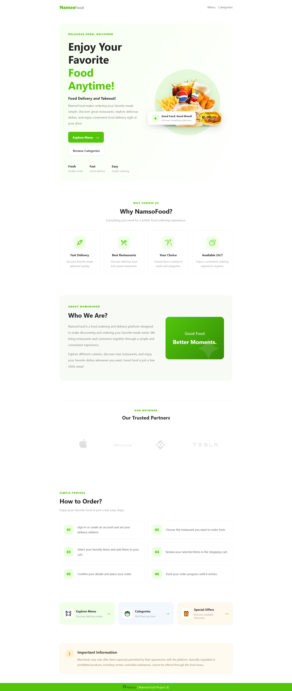
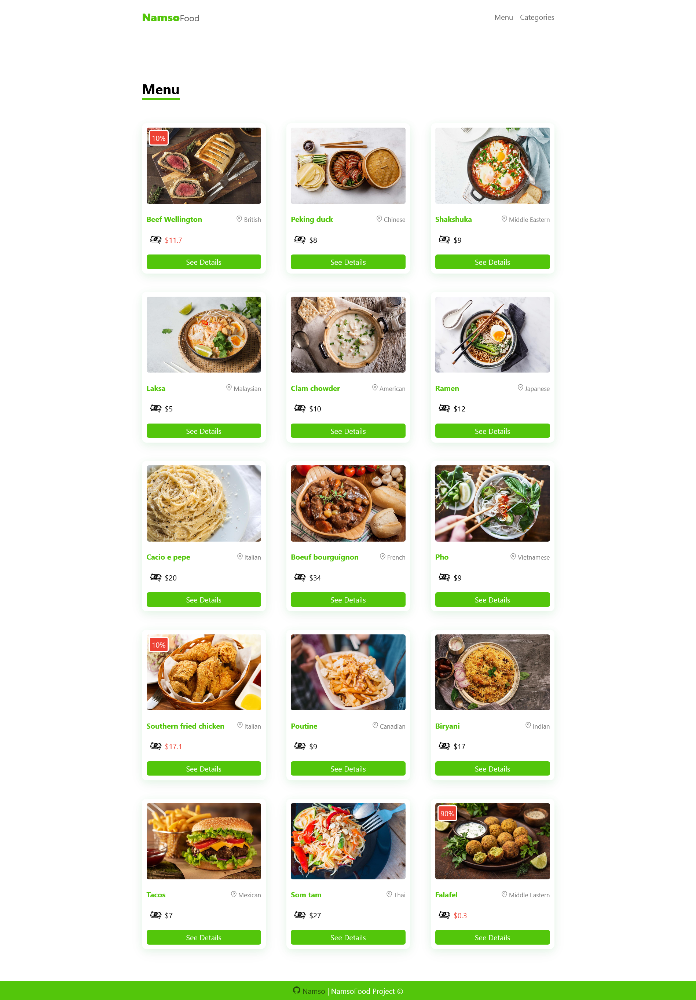
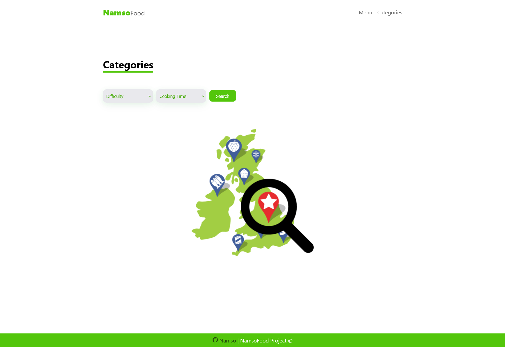
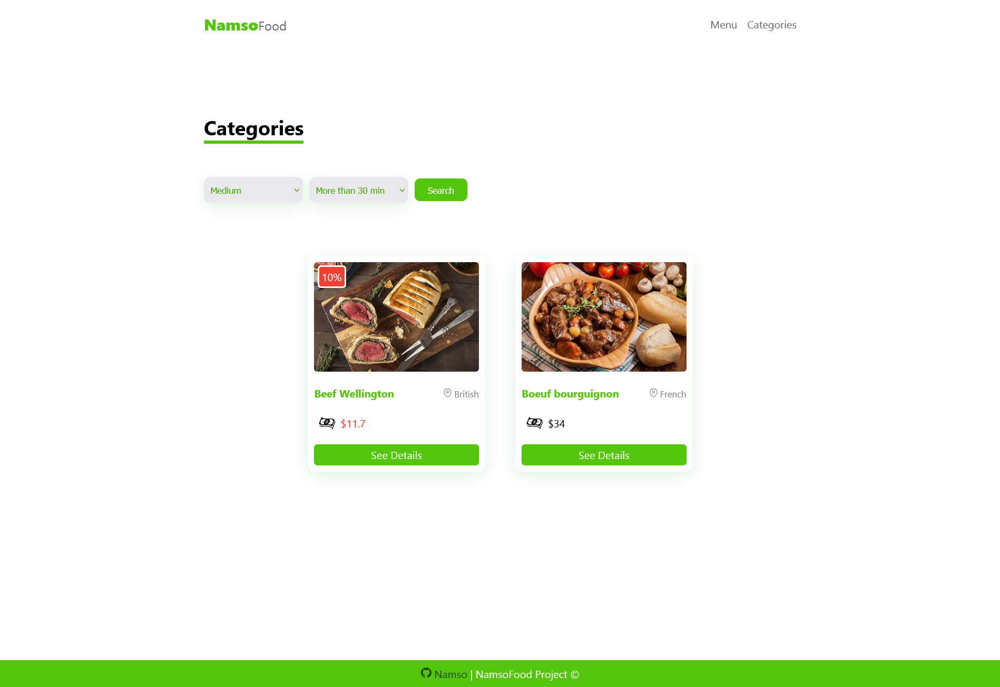
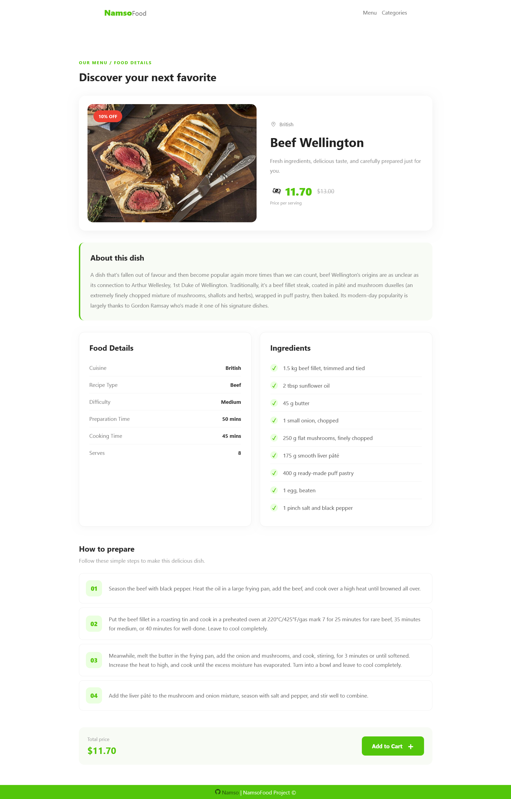
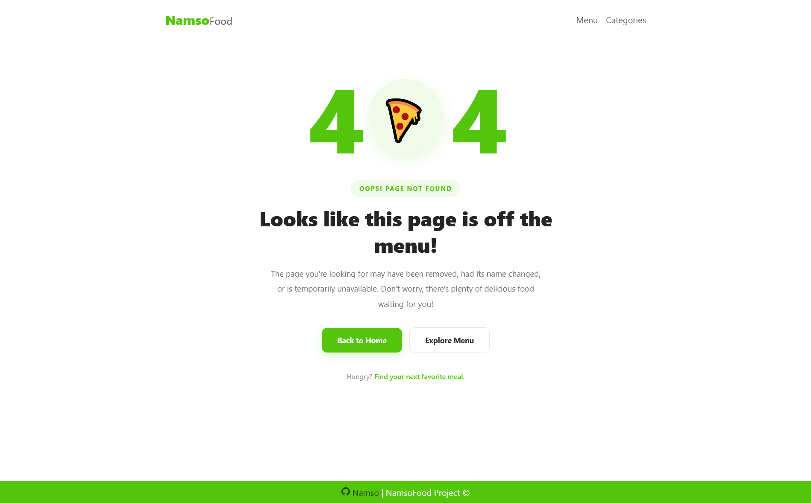

# NamsoFood 🍕

A Next.js Responsived food discovery web app where users can browse a menu, filter dishes by difficulty and cooking time, and view detailed recipe pages with ingredients, preparation steps, and pricing.

---

## Features

- **Home page** — Landing page built from modular sections (Banner, Attributes, Definition, Companies, Instruction, Guide, Restrictions).
- **Menu** — Browse all available dishes rendered as cards with image, cuisine, price, and discount badge.
- **Categories** — Filter dishes by **difficulty** (Easy / Medium / Hard) and **cooking time** (Less than 30 min / More than 30 min) using URL query params.
- **Food details** — Full recipe page with introduction, food details, ingredients checklist, numbered preparation steps, and discounted pricing.
- **Custom 404** — Friendly not-found page with links back to home and menu.
- **Responsive card grid** with hover states and discount highlighting.

---

## Tech Stack

- **Next.js** (Pages Router — SSG + SSR)
- **React** (Hooks)
- **CSS Modules** for scoped styling
- **JSON Server** (external API at `http://localhost:4000/data`)

---

## Project Structure

```
├── components/
│   ├── icons/
│   ├── layout/
│   │   └── Layout.js
│   ├── modules/
│   │   ├── Card.js
│   │   ├── Banner.js
│   │   ├── Attributes.js
│   │   ├── Definition.js
│   │   ├── Companies.js
│   │   ├── Instruction.js
│   │   ├── Guide.js
│   │   └── Restrictions.js
│   └── templates/
│       ├── HomePage.js
│       ├── MenuPage.js
│       ├── CategoriesPage.js
│       └── DetailsPage.js
├── pages/
│   ├── _app.js
│   ├── index.js
│   ├── 404.js
│   ├── menu/
│   │   ├── index.js      # SSG — all foods
│   │   └── [id].js       # SSG — single food details
│   └── categories/
│       └── index.js      # SSR — filtered foods
└── styles/
    └── globals.css
```

---

## Data Fetching Strategy

| Page          | Method                              | Notes                                                                                        |
| ------------- | ----------------------------------- | -------------------------------------------------------------------------------------------- |
| `/`           | Static                              | Composed of client components                                                                |
| `/menu`       | `getStaticProps`                    | `revalidate: 36000` (10 hours)                                                               |
| `/menu/[id]`  | `getStaticPaths` + `getStaticProps` | Pre-renders top 10 foods, `fallback: "blocking"`, 10h revalidate, `notFound` for missing IDs |
| `/categories` | `getServerSideProps`                | Reads `difficulty` & `time` query params and filters server-side                             |

---

## Filtering Logic (Categories)

- **Difficulty** — matches against `details[].Difficulty`
- **Time** — parses `details[].Cooking Time`, extracts the numeric minutes:
  - `Less` → ≤ 30 minutes
  - `More` → > 30 minutes
- Filters are combinable; the selected values are pushed to the URL as query params so results are shareable and SSR-friendly.

## Screenshots

### Home Page



> Landing page with banner, attributes, and feature sections.

### Menu



> Browse all available dishes as cards with cuisine, price, and discount badges.

### Categories / Filter





> Filter dishes by difficulty (Easy / Medium / Hard) and cooking time (<30 min / >30 min).

### Food Details



> Full recipe view with ingredients, step-by-step preparation, and pricing.

### 404 Page



> Custom "off the menu" not-found page with quick navigation links.
